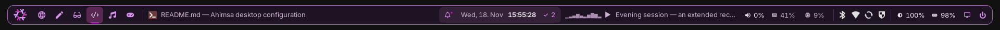
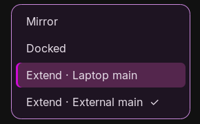
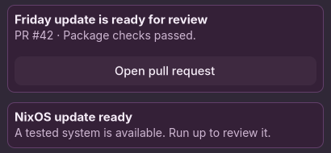

# NixOS dotfiles

Reproducible NixOS and Home Manager configuration, with support for existing-host
reinstalls and fresh devices using their own detected hardware.

Both hosts share the pinned `nixos-unstable` input; only the desktop uses Home
Manager `master`. All inputs are pinned in `flake.lock`.
Desktop state versions remain `24.11`; the VPS retains `26.05`.
Both hosts use `pkgs.linuxPackages_latest`; kernel updates require a reboot.

## Hosts

- [`ahimsa`](#ahimsa-desktop) is the primary AMD laptop and runs Hyprland.
- `ahimsa-vps`: headless media server; root SSH login with your existing key.

Each host lives under `hosts/<hostname>` with `default.nix`, `hardware.nix`, and
non-secret user metadata in `metadata.nix`. Desktop hosts include Home Manager,
also exposed separately for user-only changes; servers use a minimal profile.

### Ahimsa desktop

Waybar shows workspaces on the left, the date and time in the center, and
system controls on the right. The magenta underline marks the active workspace.



Click the bell to open notifications, or right-click it to toggle Do Not Disturb.
While the laptop is discharging, it shows a low-battery popup at 20% and a
critical alert at 10% that stays until dismissed. Plugging in re-arms both alerts.
Hover over the power button to see its label, then click to open the power menu.
The notification center, power controls, and GTK menus share the Rofi palette.

[Power controls](assets/previews/power-controls.png) · [Notification center](assets/previews/notification-center.png) · [Nemo context menu](assets/previews/nemo-context-menu.png)

Click the NixOS logo at the far left of Waybar to open Rofi and search for an app.


When an HDMI display is connected, click the monitor icon beside the power
button to choose a layout. **Mirror** shows the same desktop on both screens.
**Docked** uses the external screen alone. In either **Extend** mode, numbered
workspaces stay on the selected main screen and the other screen gets its own
workspace. The checkmark shows the current layout.



## Daily commands

These Fish functions use `$DOTFILES_REPO`, which defaults to `~/.dotfiles`:

```console
up                  # verified system + home update: now, next boot, or later
up-vps              # manual fallback for automatic VPS deployments
up-vps-status       # VPS pending/active/boot systems and recovery state
up-vps-confirm      # confirm a scheduled update after reboot
rollback-vps        # restore the previous VPS configuration over SSH
home                # verified standalone Home Manager update
flake-update        # update inputs and run quick checks on a proposal branch
dotfiles-check      # full local checks; add quick to skip system/home/VM builds
dotfiles-status     # pending, active, and next-boot systems
dotfiles-mark-good  # protect the active system after hardware testing
rollback            # previous system generation, offline
rollback-good       # protected known-good system, offline
```

VPS commands prompt for your SSH key passphrase when needed; the temporary
agent is removed when the command exits.

After main CI passes, GitHub automatically deploys the exact tested VPS revision
over SSH, checks services and HTTPS, and confirms it without rebooting. Builds
run in parallel.
Failures retain recovery backups; software rollback does not restore databases.
`VPS_SSH_KEY` is the dedicated Actions secret; server identity is pinned in
`config/vps-known-hosts`. Never reuse that key for backup decryption.

Deployment artifacts retain encrypted state/lyrics backups for 30 days (audio/video excluded).
Keep your original administrator SSH private key. Use `nix shell --inputs-from . nixpkgs#age`,
then `age -d -i <private-key> -o backup.tar.gz <backup.tar.gz.age>`.
Jellyfin logins: `breno` (administrator, previous admin password) and `bianca` (viewer).

The VPS uses Proton VPN for qBittorrent. **Before deployment**, install a root-only
**Finland P2P WireGuard** profile with NAT-PMP enabled (paid Proton plan) at
`/var/lib/private/proton-vpn/finland.conf`. Never commit the profile. qBittorrent's
API stays on localhost; tunnel failure blocks torrent traffic.
Check `systemctl status media-vpn` and `journalctl -u media-vpn-forward` on the VPS.

RuTracker uses local FlareSolverr. Add its credentials in Prowlarr, select
the `media-stack-flaresolverr` tag and `Media stack requests` sync profile, then Test/Save.

Jellyfin/Finamp use original album dates; imported music dates reconcile every five minutes.
LRCLIB fetches missing lyrics daily at 05:00 server time, preferring synced lyrics.
Admins can search/upload replacements through Jellyfin's lyrics controls.
Release matching/quality warnings can be overridden with an explicit download confirmation.

Rootless Podman, including the `docker` compatibility command, defaults to
`userns = "keep-id"` in `~/.config/containers/containers.conf`. This preserves
your UID/GID for bind-mounted files in new containers. Override with `--userns`.

## Existing installation

On a configured `ahimsa`, use `up` to install a CI-tested revision.
To reinstall a known host from the NixOS installer:

```console
sudo ./install-nixos.sh --host ahimsa --root /mnt
```

The installer does not partition or format disks. Mount the root filesystem at
`/mnt` and the EFI system partition at `/mnt/boot` first.

## Fresh device

Partition, format, and mount the device from the NixOS installer, then clone
directly onto the target filesystem:

```console
sudo mkdir -p /mnt/home/brenoslivio
sudo git clone \
  https://github.com/brenoslivio/.dotfiles.git \
  /mnt/home/brenoslivio/.dotfiles
cd /mnt/home/brenoslivio/.dotfiles

sudo ./install-nixos.sh \
  --new-device new-laptop \
  --user brenoslivio \
  --user-description "Breno Livio" \
  --email brenoslivio@pm.me \
  --root /mnt
```

Fresh-device mode generates `hosts/new-laptop/hardware.nix` with the device's
filesystem UUIDs, encryption, swap, CPU microcode, and kernel modules.
Preview without writing or installing:

```console
sudo ./install-nixos.sh --new-device new-laptop --root /mnt --dry-run
```

Run `./install-nixos.sh --help` for all options. Generated files are never
automatically staged or committed. New hosts need their own CI/update policy
before using the guarded updater, which supports `ahimsa` and `ahimsa-vps`.

## Adding a host manually

Start from `templates/host` and create:

```text
hosts/<hostname>/default.nix
hosts/<hostname>/hardware.nix
hosts/<hostname>/metadata.nix
```

Hosts with `default.nix` and `metadata.nix` are discovered automatically.
Check the new host without activating it:

```console
nix build --no-link \
  "path:$PWD#nixosConfigurations.<hostname>.config.system.build.toplevel"
```

## Personal setup after installation

Passwords, private SSH keys, and cloud credentials are absent. After installing:

1. Set the normal user's password.
2. Create or restore `~/.ssh/id_ed25519` and its public key.
3. Create Git's allowed-signers file:

   ```console
   mkdir -p ~/.ssh
   awk -v principal="$(git config user.email)" \
     '{ print principal, $1, $2 }' \
     ~/.ssh/id_ed25519.pub > ~/.ssh/allowed_signers
   chmod 600 ~/.ssh/allowed_signers
   ```

4. Authenticate GitHub CLI with `gh auth login` for update verification.
5. Sign in to Dropbox, Proton VPN, and other personal services.

Waybar's task and research widgets tolerate missing Dropbox files. Override
their paths with `TASKS_FILE` and `RESEARCH_FILE`.

## Assets

Desktop images are tracked under `assets/` and installed to
`~/.local/share/dotfiles/assets`; configuration does not depend on `~/Pictures`.
JPEG metadata has been removed. See [asset notes](assets/README.md) for the
inventory, redistribution rights, and personal photograph considerations.

## Updating and recovery

Friday proposal → PR checks → review/merge → final `main` checks → `up`.
Normal edits follow the same path: branch, edit, commit, push a PR, then merge
after CI. `dotfiles-check` runs the shared suite locally before pushing.

Weekly PRs gain per-host package/version tables after CI, with linked upstream
notes, Nixpkgs changelog/homepage links, or an explicit fallback. Full comparisons are attached as artifacts;
the first successful main CI seeds the baseline.

Weekly proposals run Friday at 15:23 UTC (12:23 São Paulo). Existing PRs and
manual fixes and their CI runs are retained. Approve bot-triggered PR CI if GitHub asks.
Merge or close the proposal and delete its branch before the next one. Use
Actions' “Run workflow” for an earlier proposal, or `flake-update` on a clean
proposal branch to update inputs locally and run quick checks.

### What `up` does

1. Requires a clean checkout on `main` and fetches its remote revision.
2. Verifies successful CI for that exact commit and `ahimsa`.
3. Fast-forwards the checkout, stopping if the histories diverged.
4. Builds or downloads the pinned system and matches its store path to CI.
5. Shows package changes and an activation preview, then offers:
   - **Apply now:** switch the system and boot default; a new kernel needs reboot.
   - **Next boot:** change the boot default while keeping the current system active.
   - **Later:** retain the candidate without changing either selection.

`up` never updates `flake.lock` or reboots. “Later” preserves any update already
scheduled for boot. Repository, active system, and boot-default revisions can
differ; `dotfiles-status` shows actual system links and recorded intent.
After interrupted activation, the actual links are authoritative.

Only successful **push** CI on the exact current `main` commit qualifies.
Shared checks, the selected host's build, and its ready gate must succeed; PR/dispatch runs, skipped jobs,
missing evidence, or an unsuccessful latest run do not qualify. Evidence binds
the repository, commit, host, platform, user, run/attempt, and build output paths.
It expires after 90 days; rerun the original push run if needed. GitHub/API
failure stops normal updates. Matching store paths verify output identity,
not independent byte-for-byte reproducibility.

### Recovery

Run `dotfiles-mark-good` after hardware testing to protect the active system.
The first activation protects the previous system automatically. Ordinary
generations are kept for 60 days; the protected baseline survives that cleanup.

Use `rollback` for the previous generation or `rollback-good` for the protected
baseline, both offline. Retained generations are also available in the boot
menu. Rollbacks restore configuration, not mutable application data.
Inspect standalone home generations with `home-manager generations`.

Pending candidates have garbage-collection roots in `~/.local/state/dotfiles`;
the protected system lives at `/nix/var/nix/profiles/dotfiles-known-good`.
The laptop checks for CI-tested updates daily at 09:15 São Paulo time.
The Friday monitor starts at 21:00 and checks GitHub every five minutes through
Sunday at 21:00. A missed timer tick runs on wake. Polling GitHub stops once
the weekly outcome is resolved.

SwayNC keeps the weekly report visible until dismissed and respects Do Not
Disturb. **Open pull request** opens the proposal in Brave when its checks pass,
fail, or need approval. A failed proposal workflow links to its Actions run.
After merge, **NixOS update ready** appears once the current `main` revision
passes the desktop updater's verification. Use `up` to review installation.
The monitor also reports a quiet week, an already-active system, or an update
scheduled for next boot. It remembers delivered statuses across restarts and
shares tested-update notices with the daily check.



Inspect the weekly monitor with `systemctl --user list-timers weeklyUpdate.timer`
and `journalctl --user -u weeklyUpdate`. Daily checks use `flakeUpdate.service`.

### GitHub setup and bootstrap

For repository setup, publish the workflows and run CI first. Then review and
run `scripts/configure-github.sh` with an authenticated administrator account.
It enables automated PRs and merged-branch deletion, and protects `main` with
PRs, up-to-date branches, and both host ready checks, including admins.
Force pushes and deletion are disabled; zero required reviewers allows solo
maintenance. Proposal automation uses `GITHUB_TOKEN`; CI starts from the PR event.
The local updater reads repository contents, pull requests, check suites, and Actions runs and artifacts.

If the installed system predates the guarded updater, start from a clean checkout
after the final `main` push CI passes. Run these commands in Bash:

```bash
git switch main
git pull --ff-only
nix shell --no-update-lock-file --inputs-from . nixpkgs#gh -c gh auth login
nix run --no-update-lock-file "git+file://$PWD?rev=$(git rev-parse HEAD)#updater" -- up
```

Bootstrap verifies the same commit and build evidence. After activation, open a
new terminal to use the installed Fish commands.

## Repository layout

```text
assets/       managed icons, wallpapers, and photographs
hosts/        machine-specific configuration, hardware, and user metadata
modules/      shared Home Manager modules and desktop configuration
scripts/      checking, update, and GitHub setup commands
system/       shared NixOS configuration
templates/    templates used by the fresh-device installer
tests/        configuration, updater, and VM checks
```
