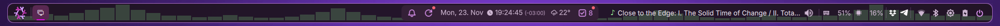
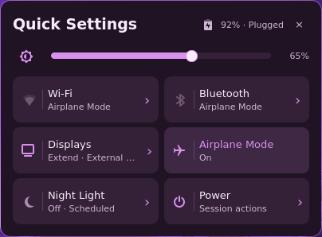
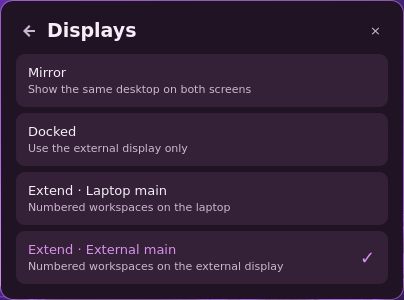
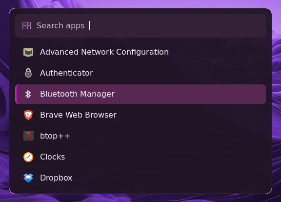

# NixOS dotfiles

Reproducible NixOS and Home Manager configuration, with support for existing-host
reinstalls and fresh devices using their own detected hardware.

Both hosts share the pinned `nixos-unstable` input; only the desktop uses Home
Manager `master`. All inputs are pinned in `flake.lock`.
Desktop state versions remain `24.11`; the VPS retains `26.05`.
Both hosts use `pkgs.linuxPackages_latest`; kernel updates require a reboot.

## Hosts

- [`ahimsa`](#ahimsa-desktop) is the primary AMD laptop and runs Hyprland.
- `ahimsa-vps`: headless media server; root SSH login with your existing key.

Each host lives under `hosts/<hostname>` with `default.nix`, `hardware.nix`, and
non-secret user metadata in `metadata.nix`. Desktop hosts include Home Manager,
also exposed separately for user-only changes; servers use a minimal profile.

### Ahimsa desktop

Quickshell shows workspaces on the left, the date and time in the center, and
system controls on the right. The magenta underline marks the active workspace.



Click the bell to read notifications on that display. Banners preview up to two
lines of message text. The center shows the full message and groups cards by
day, newest first. Opening the center marks them as read. Hover or use Tab to
dismiss individual cards, or use **Clear all**. Escape or a click
outside closes the center. Clicking a banner or card invokes the sender’s open
action, so a mail app can take you straight to the message. If the notification
only identifies its desktop app, clicking opens that app. Use the switch in the
center or right-click the bell to toggle manual Do Not Disturb.
The panel keeps history in memory and remembers manual Do Not Disturb across
restarts. Volume and microphone popups disappear after a moment.
While the laptop is discharging, it shows a low-battery popup at 20% and a
critical alert at 10% that can interrupt Do Not Disturb and stays in the center
until dismissed. Plugging in re-arms both alerts.
Choose **Power** at the bottom right of Quick Settings or press the laptop’s power key.
Selecting a session action opens a confirmation. Choose the action again to proceed, or press Escape to cancel.
The notification center, power controls, and GTK menus share the Rofi palette.

[Power controls](assets/previews/power-controls.png) · [Reboot confirmation](assets/previews/power-confirmation.png) · [Notification banners](assets/previews/notification-banners.png) · [Notification center](assets/previews/notification-center.png) · [Nemo context menu](assets/previews/nemo-context-menu.png) · [Tray context menu](assets/previews/quickshell-tray-menu.png)

Click the Wi-Fi, Bluetooth, brightness, battery, and power group to open **Quick Settings**.
Hover for brightness and battery percentages. Scroll over brightness to adjust the backlight. Click a wireless icon to toggle its radio or
the name beside it to choose a network or device. **Find devices** starts a
20-second Bluetooth scan. **Airplane Mode** blocks Wi-Fi and Bluetooth together.
Click it again to restore their previous settings. A plane icon appears in the
bar while the radios are blocked. Brightness, volume, and microphone gain update as you drag. Escape goes back, and clicking
outside closes Quick Settings.

| Quick Settings | Displays |
| --- | --- |
|  |  |

The battery shows **Plugged** whenever the adapter is online. Click the moon to toggle
**Night Light**, or click its name to set the hours and daytime and nighttime
temperatures (2500–6500 K). Lower values look warmer. At the start time, the
display takes the first of four steps toward the nighttime temperature. The
steps are an hour apart, or closer for short schedules. At the end time the
display returns to the daytime temperature.
The schedule follows the laptop’s time zone, including overnight hours. Manual warmth
lasts until the next start or end. **Resume schedule** restores the scheduled warmth.

Click the task count beside the clock to open **Projects & tasks**. Project
arrows expand or collapse their tasks. Use **+ Project** or **+ Add task** to
create an item. Enter saves a task and keeps the field ready for another.
Click a title to select it. Open **⋯** and choose **Rename** to edit its name.
The same menu offers subtasks, moves, and deletion.
When deleting a populated project, **Move tasks first…** transfers its tasks
to another project. Drag the grip on a project header to the insertion line,
or choose **Move up** or **Move down** in its menu. This also reorders its
whole subtree in Obsidian. Check off a task to complete it. **Show completed**
lets you review or reopen it.

At the top of Tasks, open **Today → + Plan task** to search by task or project.
Add several tasks, then choose **Done**. A task’s **⋯ → Do today** also adds it.
Drag the grips in Today or use **Move up** and **Move down** in a planned
task’s menu. **Focus…** starts the first unfinished task, labeled **Up next**.
Checking it off completes the task in Obsidian. **Remove from Today** leaves it
open in its project. When a new local day begins, expand **Carry over** to
add or dismiss individual unfinished tasks, or choose **Add all to today**.
The daily order is saved by note and date in `config/quickshell/task-plan.json`.

Choose **Focus…** on a task to enter minutes (`37m`), hours and minutes
(`1h 15m`), or an end time (`14:40`) in the clock’s time zone. A clock time
that has passed means tomorrow. Leave the field empty for untimed focus. The
active session stays at the top while you browse. Pause, resume, or finish it
there. Switching tasks or completing the active one saves the session.
Starting or resuming focus silences notification banners. Pausing, finishing,
or reaching the timer limit restores banners unless manual Do Not Disturb is
on.
At expiry you can extend it in Tasks or add five minutes from the notification.
The bar shows **Focusing...** during a session. Open Tasks to see today’s
focus total at the bottom of the popup. Click **Focus history** to review sessions.
The arrows jump between days with records. **Delete** removes a whole finished
session and updates its totals. **Undo** restores it during this panel session.

Select **Deadline…** or click an existing date. Choosing a day, **Today**, or
**Tomorrow** saves it immediately. Existing timed deadlines follow the clock’s
selected place until edited. Newly chosen dates stay on the same calendar day.
The Tasks button shows a red dot for overdue items or deadlines today, and
amber for either of the next two days. Hover for item names and projects.
The clock calendar opens the corresponding item when you click its title.
Completing a task hides its deadline until you reopen it.

Changes are saved to the Markdown bullets in Ikiru’s `## Tasks` section.
`TASKS_FILE` overrides the note. Right-click the panel button to open Obsidian.
Keep the trailing `^id` when renaming or moving an item in Markdown so its time
and deadlines follow it. If another editor changes an item you are editing,
the form keeps your input for review. **Recover draft…** appears when an older
notepad or capture draft is available.

Sessions and deadlines are stored in `config/quickshell/task-history.json`
under `DOTFILES_REPO`. Totals exclude pauses, **Today** uses the computer’s
local day, and deleting a task preserves its recorded time. Running sessions
survive a panel restart and timed sessions stop at the scheduled end even if the
panel was closed.

Click the NixOS logo at the far left of the panel to open Rofi and search for an app.



The audio button to the left of Memory shows the current track beside the speaker while playing or paused.
The lock screen centers available cover art below the password field, with the track title and artist underneath.
Pausing adds a **Paused** label. Stopping playback clears the title and cover.
Middle-click the title to pause or resume. The music note and the full spectrum use a color from the cover art.
Click the title or speaker for volume, mute, output and microphone selection, headset profiles, and playback.
Scroll over the button to adjust volume. Click the progress bar to jump to a time,
or drag to preview a timestamp and release to seek when the player supports it.
The back and forward mouse buttons over the song title skip tracks.
Enable **Allow volume above 100%** to raise output up to 200% with the slider,
bar scroll, or volume keys. Disabling it brings boosted output back to 100%.

Left-click the clock for the selected place’s calendar and forecast.
Choose **7 days** below the place name for daily highs, lows, and precipitation
probabilities. Hover over a weather icon for the day's condition.
Right-click the clock to select a place and set the laptop’s system time zone.
The active local desktop user can change the zone from the bar after the laptop
configuration has been activated once. Previously resolved places work offline.
Choose **Add place…**, enter a name and paste latitude and
longitude (for example, `-23.5505, -46.6333`). You can also choose **Find by street…**,
enter a street and city, and press Enter. Select a match to fill in its coordinates,
review the place name, and click **Save**. Street-only matches are approximate.
Address searches use [Photon](https://photon.komoot.io/) and OpenStreetMap.
**Manage places…** lets you edit
or remove an entry. These actions edit `config/quickshell/places.json` in
`$DOTFILES_REPO` (default `~/.dotfiles`). Commit and push it to share your places.
Open-Meteo supplies the time zone and forecast. The active forecast refreshes
every 30 minutes. Your selection and per-location offline cache stay in your
local state directory. [Open-Meteo](https://open-meteo.com/)

Click either percentage in **Resources** to see the last minute of CPU and memory
usage, available memory, swap, logical CPUs, and a searchable list of running programs.
Programs open sorted by highest memory usage. Click a column heading to re-sort,
or select a program and confirm **Force quit…** to stop it. During playback, a squared audio spectrum spans the panel.
Active screen sharing, microphone use, and camera use each show an icon beside
the volume control. Hover over an icon to see which applications are using it.

[Resources with programs sorted by memory](assets/previews/resources.png)

The panel starts with Hyprland on each display. **Super+W** stops Quickshell
and its notification center. Press it again to start both. **Super+Shift+W**
restarts Quickshell in one step, even when the panel is frozen. Use
`journalctl --user -u quickshell-panel.service -b` to inspect its log.

Open **Quick Settings → Displays** to see the current layout. Connect an HDMI
display to choose another layout. **Mirror** shows the same desktop on both screens.
**Docked** uses the external screen alone. In either **Extend** mode, numbered
workspaces stay on the selected main screen and the other screen gets its own
workspace. The checkmark shows the current layout.

## Daily commands

These Fish functions use `$DOTFILES_REPO`, which defaults to `~/.dotfiles`:

```console
up                  # verified system + home update: now, next boot, or later
up-vps              # manual fallback for automatic VPS deployments
up-vps-status       # VPS pending/active/boot systems and recovery state
up-vps-confirm      # confirm a scheduled update after reboot
rollback-vps        # restore the previous VPS configuration over SSH
home                # verified standalone Home Manager update
flake-update        # update inputs and run quick checks on a proposal branch
dotfiles-check      # full local checks; add quick to skip system/home/VM builds
dotfiles-status     # pending, active, and next-boot systems
dotfiles-mark-good  # protect the active system after hardware testing
rollback            # previous system generation, offline
rollback-good       # protected known-good system, offline
```

VPS commands prompt for your SSH key passphrase when needed; the temporary
agent is removed when the command exits.

After main CI passes, GitHub automatically deploys the exact tested VPS revision
over SSH, checks services and HTTPS, and confirms it without rebooting. Builds
run in parallel.
Failures retain recovery backups; software rollback does not restore databases.
`VPS_SSH_KEY` is the dedicated Actions secret; server identity is pinned in
`config/vps-known-hosts`. Never reuse that key for backup decryption.

Deployment artifacts retain encrypted state/lyrics backups for 30 days (audio/video excluded).
Keep your original administrator SSH private key. Use `nix shell --inputs-from . nixpkgs#age`,
then `age -d -i <private-key> -o backup.tar.gz <backup.tar.gz.age>`.
Jellyfin logins: `breno` (administrator, previous admin password) and `bianca` (viewer).

The VPS uses Proton VPN for qBittorrent. **Before deployment**, install a root-only
**Finland P2P WireGuard** profile with NAT-PMP enabled (paid Proton plan) at
`/var/lib/private/proton-vpn/finland.conf`. Never commit the profile. qBittorrent's
API stays on localhost; tunnel failure blocks torrent traffic.
Check `systemctl status media-vpn` and `journalctl -u media-vpn-forward` on the VPS.

RuTracker uses local FlareSolverr. Add its credentials in Prowlarr, select
the `media-stack-flaresolverr` tag and `Media stack requests` sync profile, then Test/Save.

Jellyfin/Finamp use original album dates; imported music dates reconcile every five minutes.
LRCLIB fetches missing lyrics daily at 05:00 server time, preferring synced lyrics.
Admins can search/upload replacements through Jellyfin's lyrics controls.
Release matching/quality warnings can be overridden with an explicit download confirmation.

Rootless Podman, including the `docker` compatibility command, defaults to
`userns = "keep-id"` in `~/.config/containers/containers.conf`. This preserves
your UID/GID for bind-mounted files in new containers. Override with `--userns`.

## Existing installation

On a configured `ahimsa`, use `up` to install a CI-tested revision.
To reinstall a known host from the NixOS installer:

```console
sudo ./install-nixos.sh --host ahimsa --root /mnt
```

The installer does not partition or format disks. Mount the root filesystem at
`/mnt` and the EFI system partition at `/mnt/boot` first.

## Fresh device

Partition, format, and mount the device from the NixOS installer, then clone
directly onto the target filesystem:

```console
sudo mkdir -p /mnt/home/brenoslivio
sudo git clone \
  https://github.com/brenoslivio/.dotfiles.git \
  /mnt/home/brenoslivio/.dotfiles
cd /mnt/home/brenoslivio/.dotfiles

sudo ./install-nixos.sh \
  --new-device new-laptop \
  --user brenoslivio \
  --user-description "Breno Livio" \
  --email brenoslivio@pm.me \
  --root /mnt
```

Fresh-device mode generates `hosts/new-laptop/hardware.nix` with the device's
filesystem UUIDs, encryption, swap, CPU microcode, and kernel modules.
Preview without writing or installing:

```console
sudo ./install-nixos.sh --new-device new-laptop --root /mnt --dry-run
```

Run `./install-nixos.sh --help` for all options. Generated files are never
automatically staged or committed. New hosts need their own CI/update policy
before using the guarded updater, which supports `ahimsa` and `ahimsa-vps`.

## Adding a host manually

Start from `templates/host` and create:

```text
hosts/<hostname>/default.nix
hosts/<hostname>/hardware.nix
hosts/<hostname>/metadata.nix
```

Hosts with `default.nix` and `metadata.nix` are discovered automatically.
Check the new host without activating it:

```console
nix build --no-link \
  "path:$PWD#nixosConfigurations.<hostname>.config.system.build.toplevel"
```

## Personal setup after installation

Passwords, private SSH keys, and cloud credentials are absent. After installing:

1. Set the normal user's password.
2. Create or restore `~/.ssh/id_ed25519` and its public key.
3. Create Git's allowed-signers file:

   ```console
   mkdir -p ~/.ssh
   awk -v principal="$(git config user.email)" \
     '{ print principal, $1, $2 }' \
     ~/.ssh/id_ed25519.pub > ~/.ssh/allowed_signers
   chmod 600 ~/.ssh/allowed_signers
   ```

4. Authenticate GitHub CLI with `gh auth login` for update verification.
5. Sign in to Dropbox, Proton VPN, and other personal services.

## Assets

Desktop images are tracked under `assets/` and installed to
`~/.local/share/dotfiles/assets`; configuration does not depend on `~/Pictures`.
JPEG metadata has been removed. See [asset notes](assets/README.md) for the
inventory, redistribution rights, and personal photograph considerations.

## Updating and recovery

Friday proposal → PR checks → review/merge → final `main` checks → `up`.
Normal edits follow the same path: branch, edit, commit, push a PR, then merge
after CI. `dotfiles-check` runs the shared suite locally before pushing.

Weekly PRs gain per-host package/version tables after CI, with linked upstream
notes, Nixpkgs changelog/homepage links, or an explicit fallback. Full comparisons are attached as artifacts;
the first successful main CI seeds the baseline.

Weekly proposals run Friday at 15:23 UTC (12:23 São Paulo). Existing PRs and
manual fixes and their CI runs are retained. The proposal workflow pushes the branch
with its built-in token and opens the PR as a GitHub App so PR checks start automatically.
Merge or close the proposal and delete its branch before the next one. Use
Actions' “Run workflow” for an earlier proposal, or `flake-update` on a clean
proposal branch to update inputs locally and run quick checks.

### One-time setup for automatic Friday PR checks

1. Register a private GitHub App under your account. Set the homepage to this
   repository, disable webhooks, and grant **Contents** read-only and
   **Pull requests** read and write.
2. Install the app on this repository only and generate a private key in the app settings.
3. Under the repository’s **Settings → Secrets and variables → Actions**, add the
   app’s client ID as the variable `FLAKE_UPDATE_APP_CLIENT_ID` and the contents
   of the downloaded PEM file as the secret `FLAKE_UPDATE_APP_PRIVATE_KEY`.

### What `up` does

1. Requires a clean checkout on `main` and fetches its remote revision.
2. Verifies successful CI for that exact commit and `ahimsa`.
3. Fast-forwards the checkout, stopping if the histories diverged.
4. Builds or downloads the pinned system and matches its store path to CI.
5. Shows package changes and an activation preview, then offers:
   - **Apply now:** switch the system and boot default; a new kernel needs reboot.
   - **Next boot:** change the boot default while keeping the current system active.
   - **Later:** retain the candidate without changing either selection.

`up` never updates `flake.lock` or reboots. “Later” preserves any update already
scheduled for boot. Repository, active system, and boot-default revisions can
differ; `dotfiles-status` shows actual system links and recorded intent.
After interrupted activation, the actual links are authoritative.

Only successful **push** CI on the exact current `main` commit qualifies.
Shared checks, the selected host's build, and its ready gate must succeed; PR/dispatch runs, skipped jobs,
missing evidence, or an unsuccessful latest run do not qualify. Evidence binds
the repository, commit, host, platform, user, run/attempt, and build output paths.
It expires after 90 days; rerun the original push run if needed. GitHub/API
failure stops normal updates. Matching store paths verify output identity,
not independent byte-for-byte reproducibility.

### Recovery

Run `dotfiles-mark-good` after hardware testing to protect the active system.
The first activation protects the previous system automatically. Ordinary
generations are kept for 60 days; the protected baseline survives that cleanup.

Use `rollback` for the previous generation or `rollback-good` for the protected
baseline, both offline. Retained generations are also available in the boot
menu. Rollbacks restore configuration, not mutable application data.
Inspect standalone home generations with `home-manager generations`.

Pending candidates have garbage-collection roots in `~/.local/state/dotfiles`;
the protected system lives at `/nix/var/nix/profiles/dotfiles-known-good`.
The circular arrow beside the panel bell checks the flake update PR and the
verified desktop revision on `main` every five minutes while the laptop is awake.
A missed check runs once on wake. Left-click to refresh immediately. The arrow
spins as soon as you click. Automatic checks start the animation after half a
second. The dot stays in place while the arrow turns.

Hover to see the Friday update, other open non-draft pull requests targeting
`main`, the desktop update status, and the time of the last successful check.
Each PR shows CI for its latest commit. Lavender means CI is pending or running,
or GitHub is still checking mergeability. Red means CI failed, CI needs approval
to run, or CI passed and the PR is ready to merge or blocked by GitHub. A verified
system update available through `up` also shows red until it is active or scheduled
for next boot. A local development build can differ from an already-applied
verified revision. The tooltip explains this and the system update dot stays clear.
Red takes priority over lavender. With no eligible PRs or updates,
the arrow has no dot. Right-click to open a PR by number or follow the Friday and main CI links.
The Friday GitHub workflow creates proposals. The indicator only reads GitHub.
If offline, it keeps the last known status. After a rate limit it waits until
GitHub permits another check.

Inspect the timer with `systemctl --user list-timers dotfiles-update-check.timer`
and the check log with `journalctl --user -u dotfiles-update-check.service`.

### GitHub setup and bootstrap

For repository setup, publish the workflows and run CI first. Then review and
run `scripts/configure-github.sh` with an authenticated administrator account.
It enables automated PRs and merged-branch deletion, and protects `main` with
PRs, up-to-date branches, and both host ready checks, including admins.
Force pushes and deletion are disabled; zero required reviewers allows solo
maintenance. Proposal automation uses `GITHUB_TOKEN`; CI starts from the PR event.
The local updater reads repository contents, pull requests, check suites, and Actions runs and artifacts.

If the installed system predates the guarded updater, start from a clean checkout
after the final `main` push CI passes. Run these commands in Bash:

```bash
git switch main
git pull --ff-only
nix shell --no-update-lock-file --inputs-from . nixpkgs#gh -c gh auth login
nix run --no-update-lock-file "git+file://$PWD?rev=$(git rev-parse HEAD)#updater" -- up
```

Bootstrap verifies the same commit and build evidence. After activation, open a
new terminal to use the installed Fish commands.

## Repository layout

```text
assets/       managed icons, wallpapers, and photographs
hosts/        machine-specific configuration, hardware, and user metadata
modules/      shared Home Manager modules and desktop configuration
scripts/      checking, update, and GitHub setup commands
system/       shared NixOS configuration
templates/    templates used by the fresh-device installer
tests/        configuration, updater, and VM checks
```
